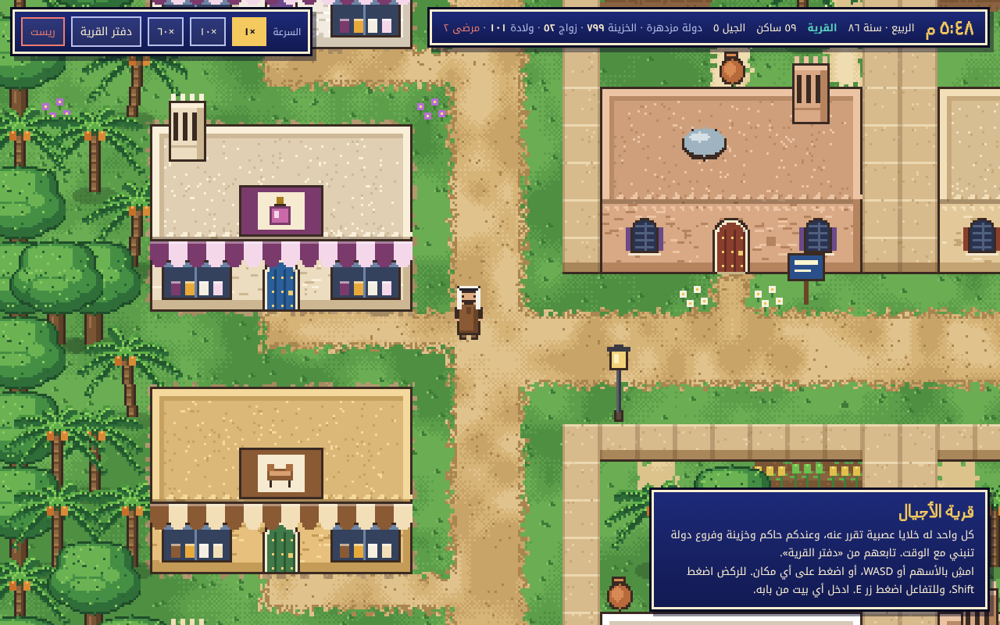
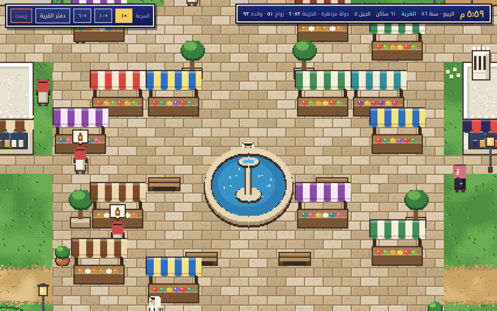
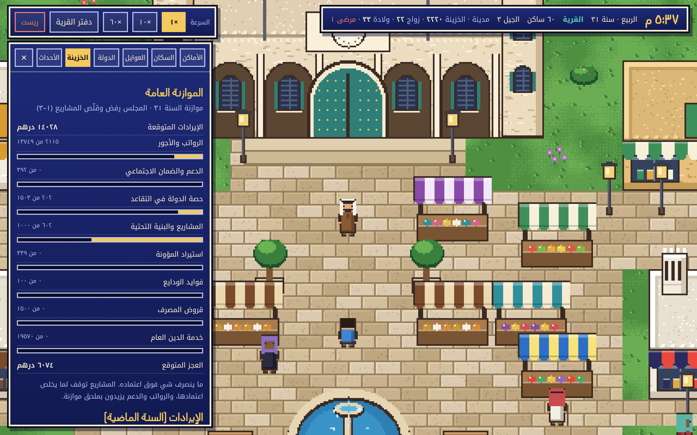
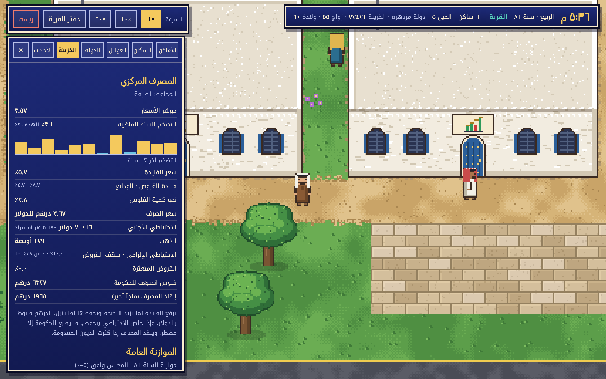
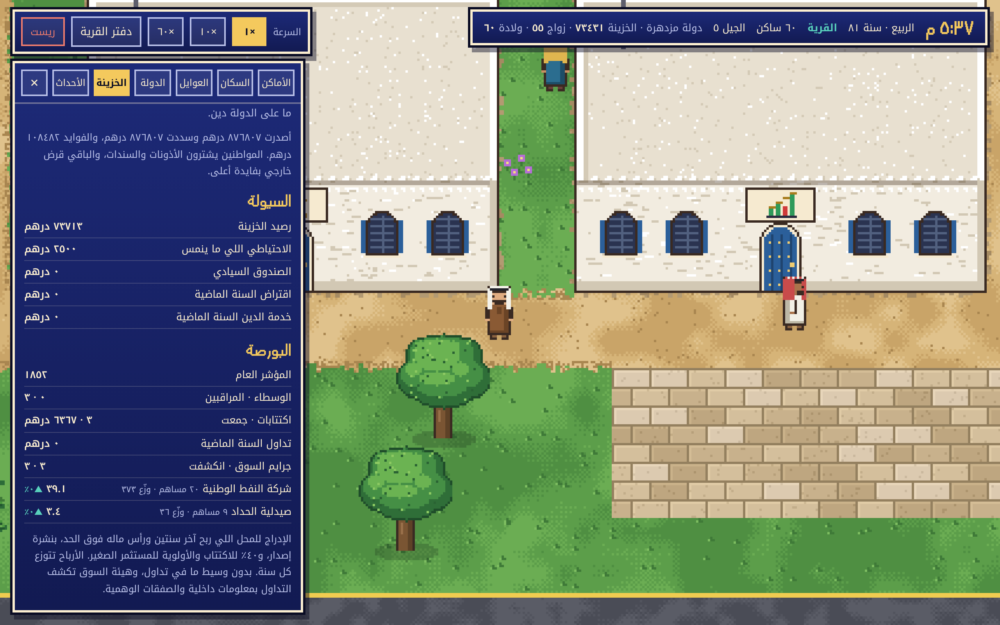
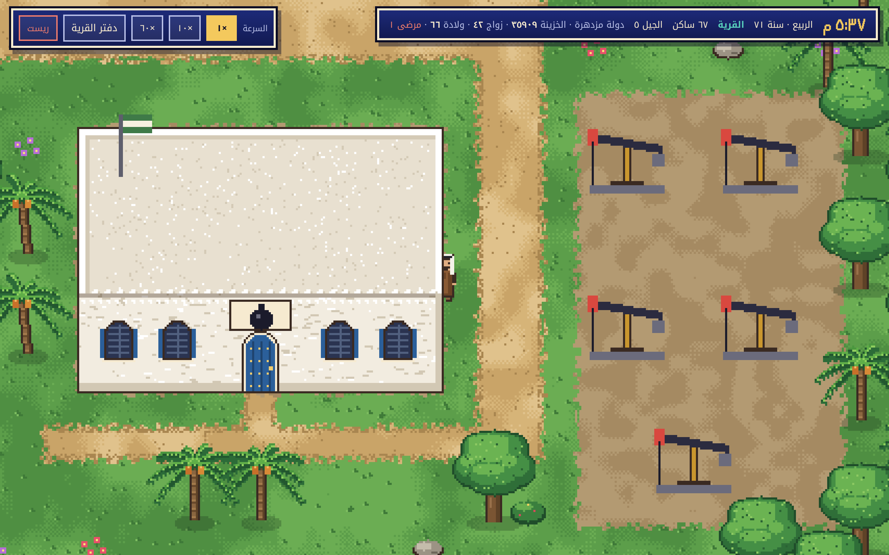
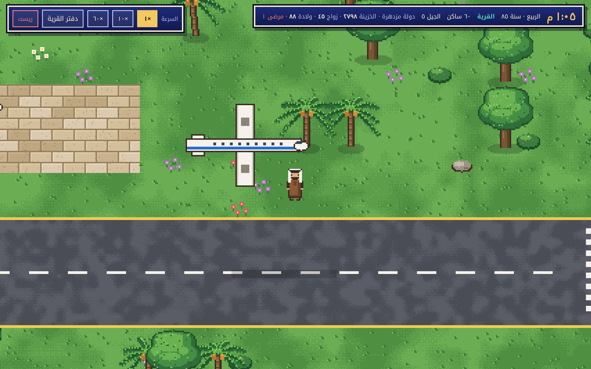

<div dir="rtl">

# قرية الأجيال 🏘️

**لعبة محاكاة قرية خليجية بستايل ١٦-بت.** كل ساكن في القرية عنده شبكة عصبية صغيرة تقرر عنه، يتعلم من نتايج قراراته، ويورّث عقله لعياله. القرية فيها دولة وخزينة وبنك مركزي وبورصة ومجلس شورى ومحكمة، وتعيش أجيال ورا أجيال.

▶️ **العبها الحين:** https://hussain-al-najar.github.io/qaryat-al-ajyal/



## وش فيها

- **أجيال حقيقية:** ولادة، مدرسة وجامعة، زواج، شغل، تقاعد، وموت. السنة في اللعبة أربعة أيام عشان تشوف الأجيال تتعاقب بسرعة.
- **خلايا عصبية لكل شخص:** شبكة (١٦ حاسة ← ١٠ خلايا مخفية ← ٩ قرارات) تتعلم بالمكافأة وتنورث من الأب والأم مع طفرات.
- **دولة كاملة:** حاكم يقرر الضرايب والصرف، فروع حكومية تنبني وتتطور، مجلس شورى يصوّت على القوانين، محكمة، وصندوق تقاعد.
- **اقتصاد:** سوق بالعرض والطلب، محلات وسجلات تجارية، بنك مركزي يتحكم بالفايدة والتضخم، بورصة وأسهم، دين عام، نفط، مطار وسياحة.
- **صحة:** أمراض ومستشفى وعلاج.
- **عالم تمشي فيه:** تقدر تمشي بين البيوت والمحلات وتدخل المباني وتتابع كل شي من «دفتر القرية».

## صور

| | |
|---|---|
|  |  |
|  |  |
|  |  |

## التشغيل

ما تحتاج تثبّت شي. افتح `index.html` في المتصفح مباشرة، أو شغّل سيرفر محلي:

```bash
python -m http.server 8000
```

وبعدها افتح http://localhost:8000

### التحكم
| الزر | وش يسوي |
|---|---|
| الأسهم / WASD | المشي |
| Shift | الركض |
| E | التفاعل |
| الضغط على الخريطة | يمشي للمكان |
| ×١ / ×١٠ / ×٦٠ | سرعة الوقت |

## الاختبار

```bash
node test/sim.test.js
```

يشغّل ٩٠ سنة محاكاة على بذرتين ويتأكد إن القرية عايشة والاقتصاد سليم (ياخذ حوالي دقيقة ونص).

## هيكل المشروع

| الملف | الدور |
|---|---|
| `index.html` | الصفحة والواجهة |
| `js/data.js` | الإعدادات، الأسماء، البضائع، الوظايف، فروع الدولة، القوانين |
| `js/world.js` | خريطة القرية والمباني |
| `js/brain.js` | الشبكة العصبية والتعلم والوراثة |
| `js/sim.js` | المحاكاة كاملة، و API القرية |
| `js/art.js` | الرسم البكسلي |
| `js/game.js` | الواجهة والتحكم |
| `test/sim.test.js` | اختبار المحاكاة بدون متصفح |
| `docs/screenshots/` | صور اللعبة |

## ربط وكيل ذكي

تقدر تضيف شخص للقرية بعقل من عندك بدل الشبكة العصبية:

```js
village.addAgent({ name: 'سالم', gender: 'm', age: 25, brain: myBrain });
```

`brain` هو اللي يقرر عن هالشخص، وهنا تقدر تربط نموذج ذكاء اصطناعي مثل Claude.

## الرخصة

المشروع مفتوح المصدر تحت رخصة [MIT](LICENSE).

</div>
